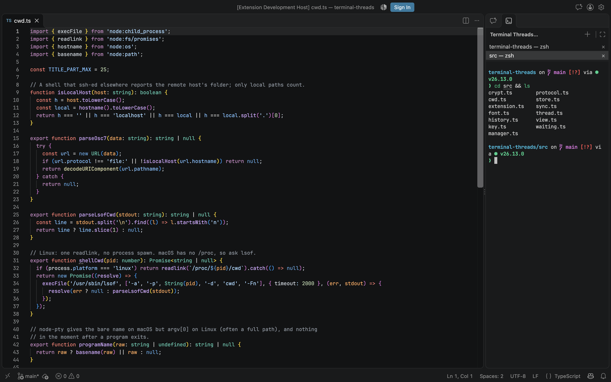

# Terminal Threads

Independent terminal "threads" in VS Code's right sidebar, modeled on [Zed's Terminal Threads](https://zed.dev/docs/ai/terminal-threads). Keep several long-lived sessions (a coding agent, a dev server, a build) side by side, separate from VS Code's own Terminal panel, with their history kept across restarts.



> A personal project, shared as is. macOS (Apple Silicon) and Linux (x64, arm64) only, including Remote-SSH. No Windows.

## What it does

- **Threads in the right sidebar.** `+` opens a new thread: a plain login shell in the workspace folder. Nothing is auto-run.
- **Live titles**, Zed style: `folder — program`, updated as you `cd` or start a program. Right-click → **Rename** to pin a name (empty restores the live title).
- **History survives restarts.** After a reload or restart each thread comes back in order with its scrollback (up to 5,000 lines), a `── session ended ──` line, and a fresh shell in the folder it was last in. If a full-screen program (an agent TUI, vim) was open, its last screen is kept as a still picture above the line.
- **A waiting dot** on a thread that finished at least ~10 s of output while you weren't looking, plus a notification when the sidebar is hidden or VS Code is in the background. Short commands like `ls` never mark.
- **Fast rendering** with xterm.js's WebGL renderer (falls back to the DOM renderer).
- **Follows your terminal font**: `terminal.integrated.fontFamily`/`fontSize`/`lineHeight`, falling back to the editor's. `terminalThreads.fontSize` sets a size for this view only.

## Saved history and secrets

Terminal output often contains secrets (`cat .env`, tokens printed by CLIs), and this extension saves output to disk. So:

- History files are **encrypted** (AES-256-GCM) with a key kept in VS Code's secret storage (your OS keychain). Over Remote-SSH the key stays on your local machine; the remote host only ever holds ciphertext.
- Files and folders are owner-only (`0600` / `0700`).
- **Right-click → Clear History** wipes a thread's scrollback and its saved file at once (refused while a full-screen program is open, since that screen isn't the scrollback).
- `terminalThreads.saveHistory: false` stops saving and deletes saved history. Threads still come back, empty.
- `terminalThreads.historyEncryption: "off"` keeps saving but as readable owner-only files, for Remote-SSH from several computers (each has its own key) or a Linux desktop without a keyring. It's a user setting only, so a workspace's `.vscode/settings.json` can't switch it off. Switching either way rewrites files on the next save.

This protects copies of the files (backups, syncs, other accounts or admins on a remote host, disk scrapers). It does not protect against anything already running as you while VS Code is open, and it doesn't touch your shell's own history file. If VS Code loses the key (a reset keychain, another computer), saved history can't be read; you're told once and those threads start empty. On a Linux desktop without a keyring, VS Code's secret storage itself is weak.

## Settings

| Setting | Default | |
|---|---|---|
| `terminalThreads.fontSize` | unset | Font size for this view; unset follows `terminal.integrated.fontSize`. |
| `terminalThreads.saveHistory` | `true` | Save history across restarts. Off deletes it. |
| `terminalThreads.historyEncryption` | `"on"` | `"off"` saves history as readable owner-only files. User settings only. |

## Install

Download the `.vsix` for your platform from Releases, then `code --install-extension terminal-threads-<platform>-<version>.vsix`. For Remote-SSH, install the Linux package from the Extensions view while connected. VS Code may place the view in the left sidebar on first use on older versions; drag it to the right once.

## Build

```sh
npm ci
npm run build && npm run typecheck && npm test
npm run package   # darwin-arm64, linux-x64 and linux-arm64 .vsix files
```

Tests spawn real shells (node's built-in test runner, no framework). The Linux build uses node-pty's own prebuilds (glibc 2.28 or newer); CI also runs the suite in an AlmaLinux 8 container to check that floor.

## Notes

- `media/webview.ts` carries a small shim for an Electron/Chromium canvas-font regression that makes xterm's WebGL glyphs tiny in VS Code 1.147 ([xterm.js#6297](https://github.com/xtermjs/xterm.js/issues/6297)); VS Code applies the same fix to its own terminal. Remove it once xterm.js ships [#6312](https://github.com/xtermjs/xterm.js/pull/6312).
- Built on [xterm.js](https://github.com/xtermjs/xterm.js) and [node-pty](https://github.com/microsoft/node-pty) (pinned to `1.2.0-beta.18`, the build VS Code itself ships).

## License

MIT
